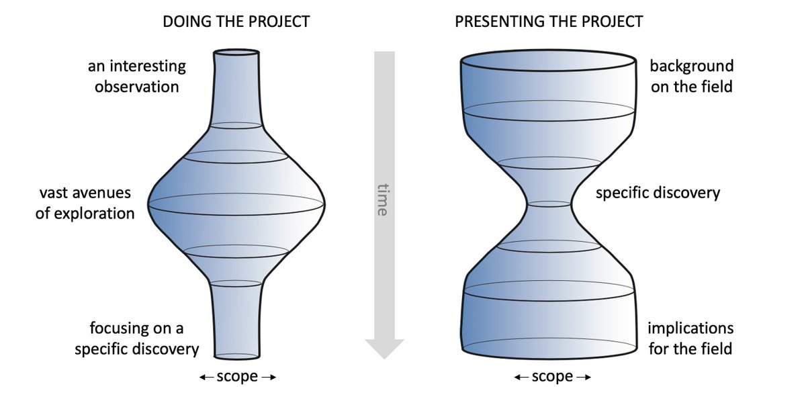
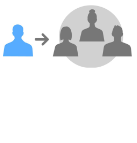
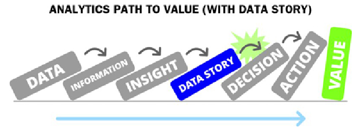

## Doing vs. Presenting Projects {.smaller}

{height="400"}

Lesson: How much time we spend on doing a project is not reflected in how much time we spend presenting a project.  

::: aside
Source: <https://x.com/ItaiYanai/status/1847127686612758569>
:::

## Milestones: From 2 to

[**2 Main insight** 💡]{style="font-size: 1.5em;"} 

**Target Achievements:** 

-   Target audience described
-   List of 3-6 (depending on team size) insights drafted in your report
-   Prioritized what will be the main insights

. . . 

[**3 Visual Drafts** 📊📈📉️]{style="font-size: 1.5em; color:gray;"}

::: {style="color:gray;"}

**Target Achievements:** 

-   For each insight
    -   a visuals drafted in the report or the presentation (a draft can be a first coded visual, or even photo of a sketch on paper)
    -   notes and ideas for the final version
:::

## Data Literacy {.smaller}

**Definition:** The ability to understand and communicate data.

**Challenge for the Data Story**

::: incremental
- [Bring your main insights across to an **audience with low and intermediate data literacy**!]{style='color:blue;'}
- [**Second order challenge:** Present it this way in class, although we (hopefully) have high data literacy. Make it simple, do not make it sophisticated to look competent.]{style='color:blue;'}
::: 

## What is an **insight**? {.smaller}

**Etymology:** "inner sight" or “  sight with the ‘eyes’ of the mind”

**A Definition:** an *unexpected shift* in the way we understand things

. . .

However: Do not feel too much presured! 

- The insight need not be new. 
- It also does not need to be unexpected to you or everybody. 

It is more an *attitude* of holding your main insight to be *interesting* and *important* for you and your audience.

## Which perspective of communication shall the project have? {.smaller}

You can communicate to the audience from the position of an

::: {.columns}
::: {.column width="50%"}

   
**Insider**

:::
::: {.column width="50%"}

   
**Outsider** 

:::
:::

. . . 

[What is the story telling position in your project?]{style='color:blue;'}

## Path to value {.smaller}

{width="50%"}

. . . 

[Think about a potential role your project report could have for your audience.]{style='color:blue;'}

# Tasks

## Task 1: Audience

Think about the audience of your report: The people you imagine to view your presentation or read your report. 

- Describe three different potential individuals in your audience. 
- Imagine a broader audience than our class! 
- Answer for example: 
  - Who are they? 
  - Why are they interested? 
  - What is their connection to the topic?

[In class: Describe one individual.]{style="color:red;"}

::: aside
This is called the **Persona method** coming from *Design thinking*. Personas help to empathize with users by giving abstract data a human face. Instead of designing for "users aged 25-40," you design for "Sarah, a 32-year-old marketing manager who commutes 90 minutes daily and needs to manage projects on her phone."
:::

## Task 2: Short Version of Story

**Abstract**

Write a short version of your story in the format of an abstract (6-7 sentences, 150-200 words)

Example Abstract for the Data Story [CoViD Pandemic and Summerbreaks](https://janlorenz.github.io/summerbreakcovid/) on the website. 

. . .

**One Sentence**

Write a one-sentence version of the abstract which contains the main point of your report.

Example for the Data Story [CoViD Pandemic and Summerbreaks](https://janlorenz.github.io/summerbreakcovid/):  

> School holidays and summer vacation made the spread of CoViD19 faster, probably because prevention measures at school and in the work place worked better than those for leisure activites and those taken with relatives and friends.

[In class: Describe one individual.]{style="color:red;"}

## Task 3: Main Insights

[**What can be main insights of your Data Story?**]{style='color:blue;'}

[Activity: In teams]{style='color:red;'}
[Option: Work on Whiteboards in Teams.]{style='color:red;'}

1. List at least 3 potential main insights/story points, better more   
(It's okay if the insights are uncertain for now because you do not know yet)

Next: 
[Activity: In groups of teams]{style='color:red;'}

## Task 4: Prioritize Main Insight

[**Discuss and select main insight of your Data Story?**]{style='color:blue;'}

[Activity: In groups of teams]{style='color:red;'}

2. Discuss each Data Story in your group and 

- select a *tentative* main insight (not binding)
- also list other insights
- list also essential information/concepts you want to communicate

Role of other project members: Ask questions
 
- What is important to know as an outsider? 
- What is most interesting as main insight? Why?

[In class: Show your Notes/Whiteboard?]{style="color:red;"}
